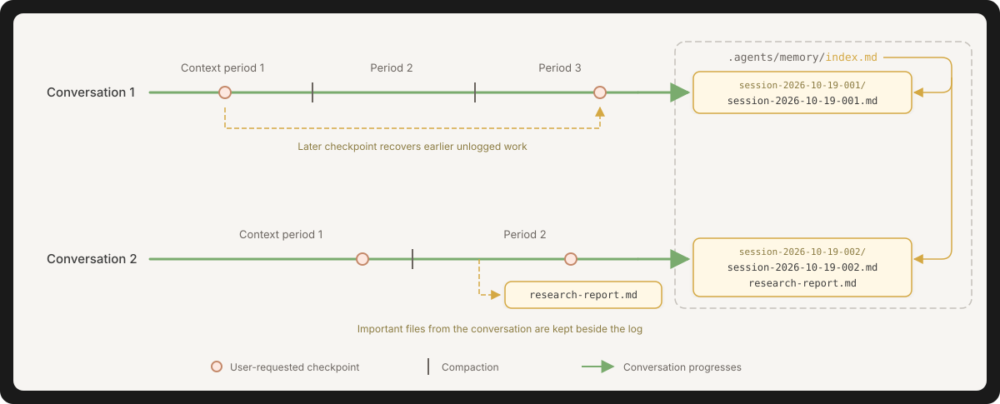

# Simple Conversation Memory for agents

A skill for Claude Code and Codex that keeps one Markdown log per conversation
across compactions and model changes. Logging runs when you request it or an
established workflow requires it.

<p align="center">
  
</p>

## Install

Install the plugin in each assistant you use. Each install adds the
`simple-conversation-memory` skill from the same marketplace.

<details>
<summary><strong>Claude Code</strong></summary>

Run in Claude Code and choose user-wide or project scope when installing:

```text
/plugin marketplace add sdi2200262/simple-conversation-memory-for-agents
/plugin install simple-conversation-memory@simple-conversation-memory-for-agents
```

</details>

<details>
<summary><strong>Codex</strong></summary>

Run in a terminal:

```sh
codex plugin marketplace add sdi2200262/simple-conversation-memory-for-agents
codex plugin add simple-conversation-memory@simple-conversation-memory-for-agents
```

Start a new Codex session after installation.

</details>

## Use

Ask your agent to save progress, recover context from past conversations, or
prepare a handoff. You can also invoke `simple-conversation-memory` directly.

Your agent writes to memory when you request it or an established workflow
instructs it to, including autonomous workflows. Each log update records current
state and next steps, groups history into periods separated by compactions, and
recovers missing earlier work from available transcripts. The log identifies
sources and gaps.

Logs and important supporting files live in dated folders under `.agents/memory/`,
linked from `index.md`. An established location for conversation logs takes
precedence.
For orientation at startup, add an index pointer to `AGENTS.md` or `CLAUDE.md`.

Ask your agent to archive completed conversations into concise summaries,
keeping important supporting files alongside them and preserving the originals
in a ZIP.

## License

[MIT](LICENSE).

<p align="center">
  <a href="https://github.com/sdi2200262" target="_blank">
    
  </a>
</p>
